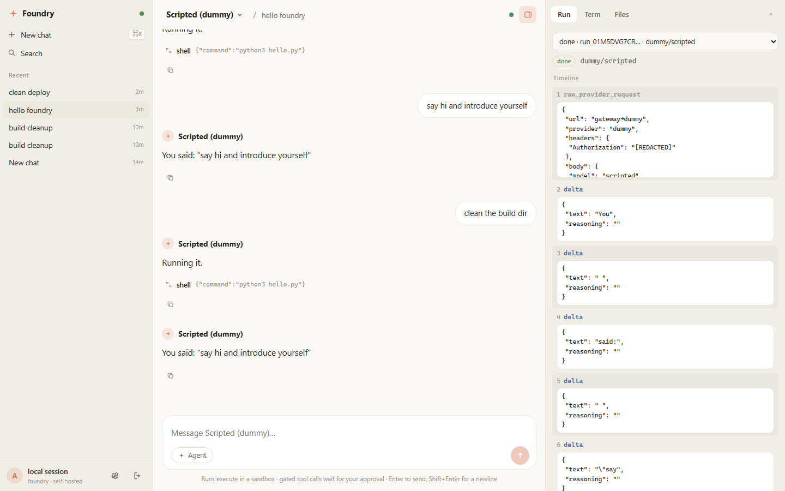
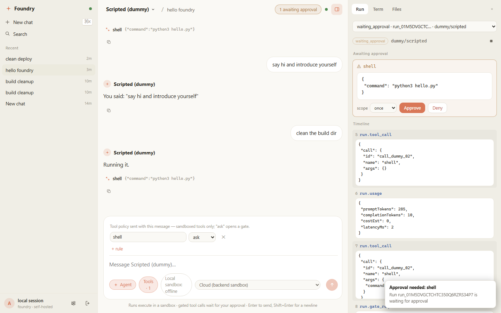
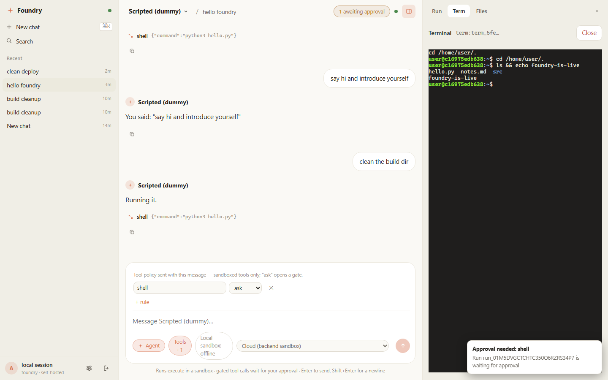

# Foundry — handoff spec package

**What this is:** a complete design spec for a self-hosted LLM backend —
API gateway + OpenAI-compatible provider switchboard + autonomous agent
runtime + sandboxed VM/terminal + filesystem — written to be executed by an
autonomous coding agent (Claude Code). Generated 2026-10-07. No code exists
yet; these docs are the source of truth.

**Working codename:** `foundry` (placeholder — rename freely). Owner: Anthony.

## How to use with Claude Code

1. Create the real repo (e.g. `foundry`), copy **everything** in this folder
   to the repo root (so `CLAUDE.md` sits at root — Claude Code auto-loads it).
2. Start Claude Code in the repo and say:
   > Read CLAUDE.md, then docs/build-order.md. Start P0.
3. After each phase, make the agent run the phase's acceptance criteria before
   moving on. `docs/build-order.md` is the TODO list; `docs/protocol.md` is
   the contract all three frontends will code against.

## File map

| File | Purpose |
|---|---|
| `CLAUDE.md` | Agent instructions: mission, pinned stack, guardrails, conventions |
| `docs/architecture.md` | Components, planes, data flows, sandbox drivers, deployment |
| `docs/protocol.md` | **v0 wire protocol** — private WS + OpenAI-compatible REST |
| `docs/data-model.md` | SQLite schema (WAL) + blob store + vector index |
| `docs/build-order.md` | Phases P0–P5, tasks, acceptance criteria, first sprint |
| `docs/decisions.md` | Ten ADRs capturing every locked-in decision |
| `docs/prior-art.md` | OpenClaw, Open Terminal, sbx, LiteLLM, E2B — what to steal |
| `assets/architecture.svg` | System diagram (v0) |

## One-paragraph summary

A single TS/Node monolith exposes two inbound planes: a typed private
WebSocket protocol for the first-party Android/Windows/web clients, and an
OpenAI-compatible REST surface (`/v1/chat/completions`) so existing tools
(Open WebUI, Cherry Studio, OpenClaw, curl) can use it as a "provider" on day
one. Outbound, adapters normalize Ollama/LM Studio/vLLM/OpenRouter/OpenAI plus
an Anthropic⇄OpenAI shim, with a key vault, routing rules, failover and usage
metering. An agent runtime executes tool-using loops inside swappable sandbox
drivers (driver #1: an Open Terminal container; driver #2: raw Docker;
Firecracker later), with approval gates (`ask`/`always`/`session`), cron +
webhook triggers, long-term memory in sqlite-vec, and MCP servers as tools.
Runs are resumable, append-only event logs. Push via ntfy; remote access via
Tailscale; zero cloud.

## What it looks like

The web client (served same-origin by core) after a real session against the
sandbox:

<p align="center">
  
</p>
<p align="center">
  
</p>
<p align="center">
  
</p>

## The sync principle

The backend is the **sync engine**. All frontends are thin views + command
senders over server-authoritative state; no client owns truth. Consistency
comes free: per-channel `seq` cursors on events, ring-buffer replay on
reconnect, `sys.resync` when a client falls outside the buffer, and refetch
methods (`chat.history`, `run.events`) as the convergence path.

## Quickstart (P5 state)

Status: P4 first client on top of P3 autonomy — provider adapters (`dummy`
scripted, `openai_compat`, `anthropic` shim), OpenAI-compatible REST with SSE
streaming, private WS plane (connect handshake, per-channel seq + replay
buffer, chat.*), agent runs with tools (`shell`, `fs.*`, `fetch`, `done`,
`mcp__<server>__<tool>`) in a sandboxed `open-terminal` container, run event
replay + boot-resume, PTY terminal at `/term`, egress credential proxy
(sandboxes never hold real keys), workspace snapshots, **approval gates**
(per-tool `ask`/`always`/`session`/`deny`, `run.approve` + ntfy, timeout
auto-deny, parked runs survive restarts), **schedules** (cron + every-seconds,
admin REST, missed ticks coalesce), **webhooks** (`POST /hook/:id`, HMAC over
the raw body, secret shown once), **long-term memory** (`memory` agent tool,
sqlite-vec top-k injection into agent runs), and **ntfy push** (run
done/failed, gate open) — plus the **P4 client layer**: `@foundry/sdk-ts` (typed
WS + REST + auto-reconnect), a **web app** (SvelteKit 2 + Svelte 5 SPA:
chat with live streaming, run timeline with approve/deny gates, terminal
(xterm.js), file browser, settings), served by core from the same origin, and
a **desktop/Windows shell** (`apps/desktop`, Tauri: a thin native window that
loads the core's origin — first-run server-URL picker, no exposed APIs) with
**dynamic container support** (ADR-015): pick per chat whether the agent's
terminal/files/commands run in the **backend's** sandbox or in a **local
sandbox** on your own machine — an Open Terminal container on your Docker
Desktop, driven by `@foundry/runner` over WS — and **push to cloud** when a
local chat should move: the runner's workspace is tared into the backend env
and a reconcile run reconstructs the dependencies you installed along the way
(the LLM reads the chat's shell history and reinstalls them). **P5 hardening**
rides the same process: per-user ownership on every run/env/chat resolution
(foreign ids 404 like unknown ones), per-user rate limit + concurrent-run
quota on `chat.send` (429/`capacity`, denied before persistence), a metered
completions plane, an append-only audit log (`GET /v1/admin/audit`), a
backup job (daily by default, `POST /v1/admin/backup` manual) and an opt-in
gVisor runtime (`FOUNDRY_SANDBOX_RUNTIME`) — see `docs/decisions.md`
ADR-016/017/018.

```sh
pnpm install                       # first time
cp .env.example .env               # then set FOUNDRY_MASTER_KEY (required)
pnpm build                         # builds core, sdk, and the web SPA
pnpm dev                           # boots on 127.0.0.1:8787 (web UI at /)
curl http://127.0.0.1:8787/healthz # -> {"ok":true,...}
pnpm test                          # unit tests (no Docker needed)
FOUNDRY_INTEGRATION=1 pnpm test    # with Docker: real open-terminal sandbox
pnpm smoke                         # REST SSE + WS chat + replay + SPA + gated run
```

Web app: open `http://127.0.0.1:8787/` — sign in with your username + password
(ADR-014: first boot creates the owner account — username from
`FOUNDRY_ADMIN_USER`, default `admin`; the generated password lands in
`data/admin_credentials.txt`, the only copy), and you get chat with streaming,
the run timeline (approve/deny gate cards, live tool events), a terminal, a
file browser over the sandbox workspace, and settings (providers, keys,
account, schedules, webhooks, MCP). API keys remain the Bearer credential for
programmatic OpenAI-compatible clients (`/v1/chat/completions`); they are not
a login method. Core serves the SPA from the same origin — no CORS,
no separate deployment; `FOUNDRY_WEB_DIR` overrides the build dir, and absent
a build core runs API-only. Dev mode: `pnpm --filter @foundry/web dev` proxies
to the core on 127.0.0.1:8787.

Android: `apps/android` (Kotlin + Compose) is a thin view over the same WS
plane — password login, streaming chats, run timeline with gate approve/deny
(once/session/always), a PTY terminal, a file browser, and the per-chat
exec-location chip with push-to-cloud; pushes surface via `notify.push` and a
self-hosted ntfy stream subscription. Build & install with Gradle
(`./gradlew :app:installDebug`) — see `apps/android/README.md`.

Agent runs: send `chat.send` with `agent: true` over WS — the loop streams
`run.*` timeline events (`run.tool_call` / `run.tool_result` / `run.status`),
executes tools inside the sandbox container, takes a workspace snapshot at run
end, and resumes from its event log if core is killed mid-run. The web
timeline shows all of it live, with gate cards when a tool waits for approval.

Terminals: open the Terminal tab in the web app, or `http://127.0.0.1:8787/term`
(xterm.js test page; put the API key in localStorage or paste it into the
page) → `term.open` / `term.input` / `term.resize` / reconnect scrollback
replay.

Sandbox egress: sandboxes hold only `esc_*` scoped tokens and call the
gateway's egress proxy (`/v1/egress/*`), which swaps real vaulted keys and
meters usage (ADR-005). On Docker Desktop set `FOUNDRY_SANDBOX_EGRESS=open`
(its kernel lacks ipset, so OT's egress firewall can't install); on Linux the
default `allowlist` mode denies everything but the gateway.

Autonomy (P3): gate a tool by sending `agent: { enabled: true, toolPolicy: {
"shell": "ask" } }` in `chat.send` — the run parks on `waiting_approval`,
ntfy pings, and `run.approve { runId, gateId, approve, scope }` (WS,
idempotent) resumes or rejects it; nothing gates unless you ask. Schedules
and webhooks are admin-REST (`/v1/admin/schedules`, `/v1/admin/hooks` → `POST
/hook/<id>` with `X-Foundry-Signature: sha256=…`). Memory persists via the
agent's `memory` tool and is recalled automatically in later chats; set
`memory.embedding_model` in settings (or run a provider with an `embed`
adapter) for vector recall, otherwise substring matching.

ntfy push: set `FOUNDRY_NTFY_URL` + `FOUNDRY_NTFY_TOPIC` — run done/failed,
gate opened, schedule/webhook fired.

Use it as an OpenAI-compatible provider from any client (curl `-N` = no buffer):

Agent runs: send `chat.send` with `agent: true` over WS — the loop streams
`run.*` timeline events (`run.tool_call` / `run.tool_result` / `run.status`),
executes tools inside the sandbox container, takes a workspace snapshot at run
end, and resumes from its event log if core is killed mid-run.

Terminals: open `http://127.0.0.1:8787/term` (xterm.js test page; put the API
key in localStorage or paste it into the page) → `term.open` / `term.input` /
`term.resize` / reconnect scrollback replay.

Sandbox egress: sandboxes hold only `esc_*` scoped tokens and call the
gateway's egress proxy (`/v1/egress/*`), which swaps real vaulted keys and
meters usage (ADR-005). On Docker Desktop set `FOUNDRY_SANDBOX_EGRESS=open`
(its kernel lacks ipset, so OT's egress firewall can't install); on Linux the
default `allowlist` mode denies everything but the gateway.

Autonomy (P3): gate a tool by sending `agent: { enabled: true, toolPolicy: {
"shell": "ask" } }` in `chat.send` — the run parks on `waiting_approval`,
ntfy pings, and `run.approve { runId, gateId, approve, scope }` (WS,
idempotent) resumes or rejects it; nothing gates unless you ask. Schedules
and webhooks are admin-REST (`/v1/admin/schedules`, `/v1/admin/hooks` → `POST
/hook/<id>` with `X-Foundry-Signature: sha256=…`). Memory persists via the
agent's `memory` tool and is recalled automatically in later chats; set
`memory.embedding_model` in settings (or run a provider with an `embed`
adapter) for vector recall, otherwise substring matching.

ntfy push: set `FOUNDRY_NTFY_URL` + `FOUNDRY_NTFY_TOPIC` — run done/failed,
gate opened, schedule/webhook fired.

Use it as an OpenAI-compatible provider from any client (curl `-N` = no buffer):

```sh
KEY=$(cat data/admin_key.txt)      # auto-minted at FIRST boot only
curl -N http://127.0.0.1:8787/v1/chat/completions \
  -H "Authorization: Bearer $KEY" -H "content-type: application/json" \
  -d '{"model":"dummy/scripted","stream":true,"messages":[{"role":"user","content":"hi"}]}'
```

Register a real provider once (stable id, idempotent — repeat calls patch):

```sh
curl http://127.0.0.1:8787/v1/admin/providers -X POST \
  -H "Authorization: Bearer $KEY" -H "content-type: application/json" \
  -d '{"id":"ollama","kind":"openai_compat","baseUrl":"http://127.0.0.1:11434",
       "models":[{"id":"ollama/gemma3:4b","name":"Gemma 3 4B","caps":{"tools":true}}]}'
# then: model "ollama/gemma3:4b" through the same /v1/chat/completions
pnpm probe:ollama  # automated version of the above against a local Ollama
```

Notes:
- `FOUNDRY_MASTER_KEY` is required; without it core refuses to start (no keys
  at rest without vault). Provider keys are accepted once via admin REST,
  stored AES-256-GCM, never echoed or logged.
- Relative `FOUNDRY_DATA_DIR` (default `./data`) resolves from the process
  cwd — start core from the repo root unless you want `apps/core/data`.
- Node: the stack pins Node 22 LTS; this machine currently runs Node 25.8.1
  (tests + boot verified on it).
- P5 knobs (all optional): `FOUNDRY_RATE_CHAT_PER_MIN` (60) /
  `FOUNDRY_RATE_API_PER_MIN` (600) / `FOUNDRY_MAX_CONCURRENT_RUNS` (8) —
  metering: `capacity` errors or 429s; `FOUNDRY_BACKUP_MIN` (1440, 0 = off) —
  backups land in `<FOUNDRY_DATA_DIR>/backups/` (keep 7);
  `FOUNDRY_SANDBOX_RUNTIME` (e.g. `runsc` for gVisor — daemon must have it;
  the runner takes `--runtime` the same way).